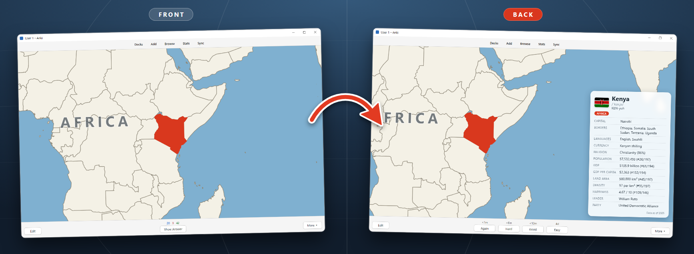
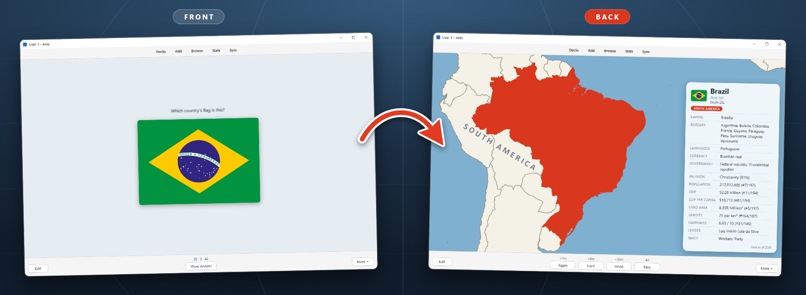
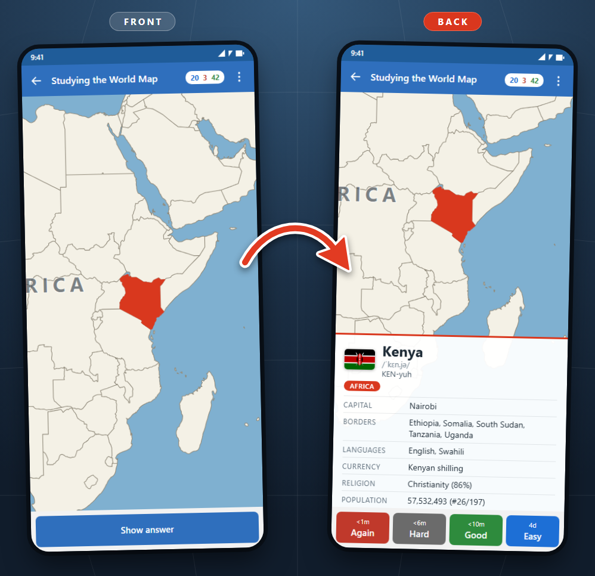
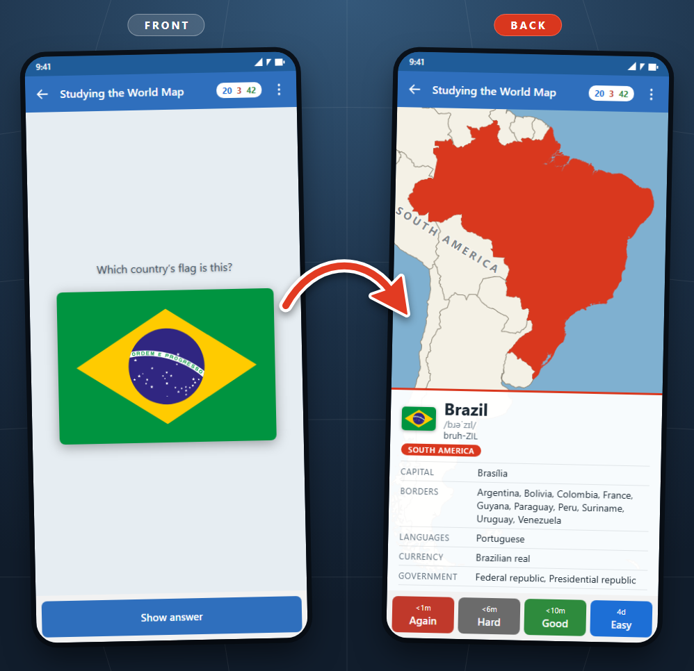
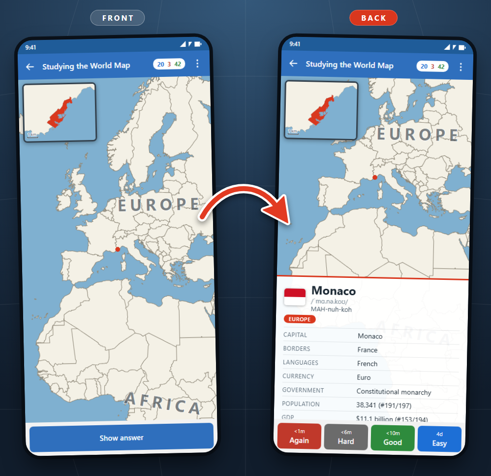
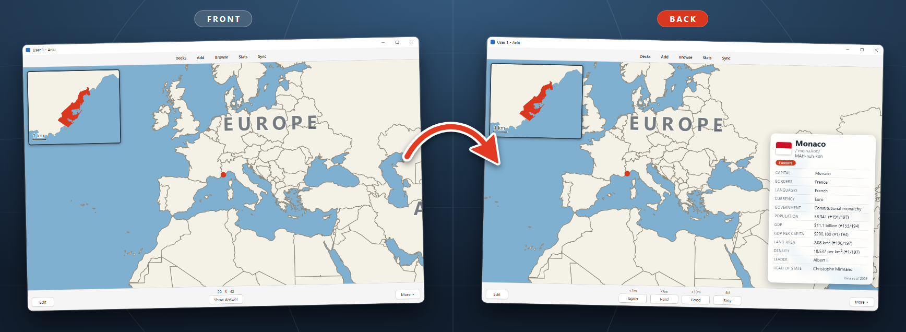

# 🌍 Studying the World Map

[](https://github.com/jackindisguise/studying-the-world-map/releases/latest)
  
[](https://ankiweb.net/shared/info/290377543) 

**An Anki deck for learning to recognise every country on a map, and a few facts about each.**
This project holds everything needed to generate the deck's data, maps and package.

---

## The deck

- **Countries:** 197 in total, the 193 UN members plus Vatican City, Palestine, Taiwan and Kosovo (`data/countries.json`).
- **Notes:** one *Country Map* note per country, keyed by its ISO 3166-1 alpha-3 code (Kosovo is `XKX`).
- **Cards:** two per note. *Locate* shows a map with the country highlighted and asks which country it is. *Flag to Country* shows the flag and asks for the country.
- **Back of the card:** name, how to say it (a plain-English respelling like `kroh-AY-shuh` and the IPA), flag, region, capital, bordering countries, languages, currency, government, religion, population, GDP, GDP per capita, land area, density, happiness score, leader, party, head of state and the date the data was gathered. Empty rows are hidden.
- **Sub-decks:** one per region (North America, South America, Europe, Africa, Central America, Caribbean, Asia, Oceania).
- **Maps:** one SVG per country, a north-up Mercator view at a fixed ground scale, with the country in red and its neighbours in grey.
- **Zoom boxes:** countries with under 3,000 km² of land also get a zoomed-in box (`zoom-<ISO>.svg`) pinned to the top-left of the card, with a scale bar. Island groups spread over more than about 150 miles are skipped, since they would only shrink to dots. Monaco and Vatican City use OpenStreetMap outlines; the rest use Natural Earth shapes.

---

## Examples

Screenshots rendered from the card templates with `node scripts/build-examples.js`, inside a mock Anki window and phone screen.

### Desktop

**Locate** (Kenya): find the red country, then flip for its facts.



**Flag to Country** (Brazil): name the country from its flag.



On the back, the map shifts to the middle of the space beside the details card, so the country isn't hidden behind it.

### Phone

The map fills the screen, and on the back it shifts up into the middle of the area above the details panel.

<table>
<tr><td align="center">Locate</td><td align="center">Flag to Country</td></tr>
<tr><td></td><td></td></tr>
<tr><td align="center" colspan="2">Tiny country (Monaco)</td></tr>
<tr><td align="center" colspan="2"></td></tr>
</table>

### Tiny countries

Countries with very little land (here Monaco) also get a zoomed-in box in the top-left corner, with a scale bar.



---

## What this project does

- **Collects the data:** pulls facts from Wikidata, the World Bank, Wikipedia and the World Happiness Report, merges them with hand-written overrides, and writes one record per country to `data/records.json`. Each numeric value (population, GDP, GDP per capita, land area, density, happiness) carries its rank among the countries that have a value, as `43,844,111 (#36/197)`; 1 is the highest and ties share a rank.
- **Adds pronunciation:** takes the US English IPA of each country name from Wiktionary and generates a plain-English respelling from it, with the same key for every country (`data/pronunciation.json`).
- **Draws the maps:** renders every country's map SVG, and the zoom boxes, from Natural Earth shapes into `build/media/`. It uses every CPU core.
- **Fetches the flags:** downloads the original flag SVGs from Wikimedia Commons (`data/flags-svg/`).
- **Writes the note file:** a single Anki-importable CSV, `build/notes.csv`, with one row per country, most populous first. It has import headers (note type, deck and tags columns); the Map and Flag fields are `` tags that point at the files in `build/media/`, named `map-<ISO>.svg`, `zoom-<ISO>.svg` and `flag-<ISO>.svg`. Import that folder's files into Anki's media folder as they are.
- **Builds the package:** bundles the notes, media and card templates into an `.apkg`, with a description on each deck.
- **Makes example images:** renders card screenshots into `docs/images/` for the AnkiWeb page (`docs/ankiweb.md`). It needs Edge or Chrome and a rendered `build/media`.
- **Keeps the card design:** stores the Anki card templates and CSS in `templates/`.

---

## Layout

- `scripts/`: data pipeline and map renderer (run everything from the package root).
- `data/`: committed inputs, which are the country list, cached Wikidata/Wikipedia/Wiktionary/World Bank/Natural Earth/happiness sources (`data/raw`), OpenStreetMap outlines (`data/raw/outlines`), flags (`flags-svg`) and the derived JSON (`facts-all`, `leaders`, `religion`, `pronunciation`, `records`).
- `templates/`: the Anki card templates, saved from the *Country Map* note type. One folder per card (`locate`, `flag-to-country`) with `front.html`, `back.html` and `style.css`.
- `docs/`: the AnkiWeb page (`ankiweb.md`) and its example images.
- `build/`: generated output, including `build/media/`, `build/notes.csv`, `build/fit/boxes.json` and the `.apkg`.

---

## Usage

Requires Node.js 22.12 or newer (developed on Node 26).

```
npm install
```

### Build everything

```
npm run build
```

Generates the map, zoom and flag images and the `notes.csv` file.

### Anki deck

```
npm run apkg
```

Bundles `build/notes.csv`, the images in `build/media/` and the card templates into `build/studying-the-world-map-<version>.apkg`, ready to import into Anki, then adds the deck descriptions. It runs the two steps below in order.

```
npm run apkg:build
```

Builds the package without descriptions.

```
npm run apkg:describe
```

Fills in each deck's description (from `data/deck-descriptions.json`) in an existing package, in place. The descriptions are Markdown, and the script turns on each deck's Markdown option. It's a separate step so you can test it without rebuilding the deck: `node scripts/add-deck-descriptions.js in.apkg out.apkg` writes to a different file.

### Render maps

Render a few maps or all of them at once. Each worker process renders a share of the countries; set `JOBS=n` to change how many (`JOBS=1` for one process).

```
node scripts/render-all.js BLZ FJI
node scripts/render-all.js
```

Countries under `ZOOM_MAX_KM2` (default 3000) get a zoom box. Per-country overrides, such as OpenStreetMap outlines, are in the `ZOOM` table in `scripts/render-all.js`.

### Example images

```
node scripts/build-examples.js
node scripts/build-examples.js MCO LUX
```

The first writes the AnkiWeb example images into `docs/images/`. With ISO codes it writes test screenshots (desktop and phone, front and back) into `build/examples/` instead.

### Pronunciation

```
npm run pronunciation
npm run records
```

Builds `data/pronunciation.json` from the cached Wiktionary lines, fetching only countries that are missing (`npm run pronunciation:refresh` fetches everything again), then puts it into the records. The US transcription is preferred, and a few countries are set by hand in `IPA_OVERRIDES` in `scripts/pronunciation.js`.

The respelling key is at the top of `scripts/respell.js`: syllables are separated by hyphens, the one with the primary stress is in capitals, "and", "of" and "the" are written as plain words, and the vowel in "price" is `ai` on its own but `y` after a consonant (`CHY-nuh`). To try a transcription: `node scripts/respell.js "kroʊˈeɪʃə"`.

### Refresh data

```
npm run refresh-data
```

Re-fetches Wikidata/World Bank facts, re-parses `data/raw/wikipedia/heads.json`, rebuilds leaders and religion, re-fetches the pronunciations from Wiktionary, then rebuilds the records. To get a fresh Wikipedia heads list, re-download it into `data/raw/wikipedia/heads.json` first. Hand overrides live in `scripts/leaders.js`.

---

## Dependencies

- `d3-geo`: map projections and geometry (area, bounds, distance, point-in-polygon).
- `topojson-client` and `topojson-server`: build the country topology that gives land borders (shared arcs) and merged continent outlines.
- `world-atlas`: 50m country shapes, used as the fast backdrop on every map.
- `anki-apkg-export`: writes the `.apkg` package (custom note type, decks, tags and media).
- `@resvg/resvg-js`: rasterizes outlines internally for the label-placement masks. No images are written with it.

---

## Data sources

Already cached in `data/`, and only fetched again by the refresh and fetch scripts, which need internet access.

- **Shapes:** Natural Earth 10m admin-0 countries (public domain), in `data/raw/natural-earth/`.
- **Zoom outlines:** OpenStreetMap (© OpenStreetMap contributors, ODbL), the detailed Monaco and Vatican City outlines, in `data/raw/outlines/`.
- **Wikidata (SPARQL):** country list, capitals, flags, languages, currency, government, parties.
- **World Bank API:** population, GDP, GDP per capita, land area, density.
- **Wiktionary (CC BY-SA):** the US English IPA of each name, in `data/raw/wiktionary/`. The respelling is generated from it by `scripts/respell.js` with one fixed key (`npm run pronunciation`).
- **Wikipedia:** the current heads of state and government list, and Pew 2020 religion figures.
- **Our World in Data:** the World Happiness Report export, for the happiness score.
- **Wikimedia Commons:** the original flag SVGs.

---

## Releases

Releases are automated with [release-please](https://github.com/googleapis/release-please) (`.github/workflows/release.yml`):

1. Commit to `main` with [conventional commit](https://www.conventionalcommits.org) titles (`feat:`, `fix:`, `docs:` and so on).
2. release-please keeps a release pull request open that bumps the version in `package.json` and the version badge in `docs/ankiweb.md`, and updates `CHANGELOG.md`.
3. Merging that pull request creates the GitHub release and the `v<version>` tag. The workflow then runs `npm run build` and `npm run apkg` and attaches `studying-the-world-map-<version>.apkg` to the release.
