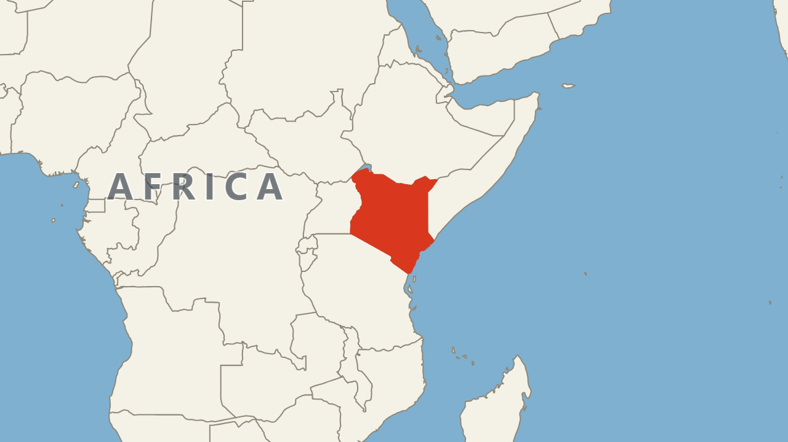
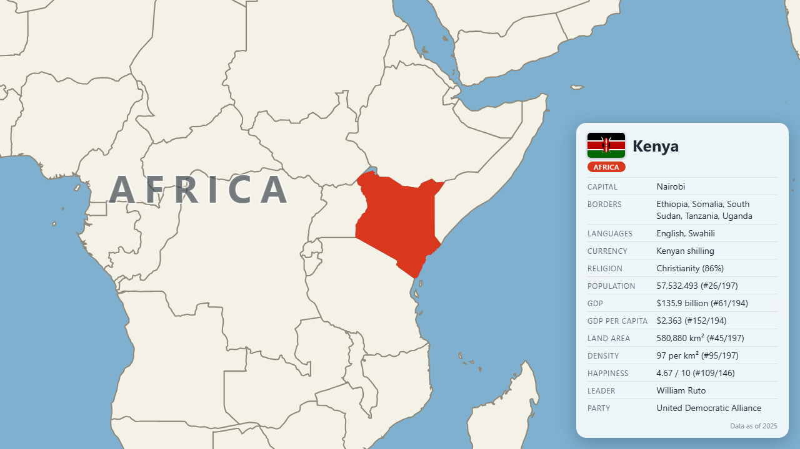
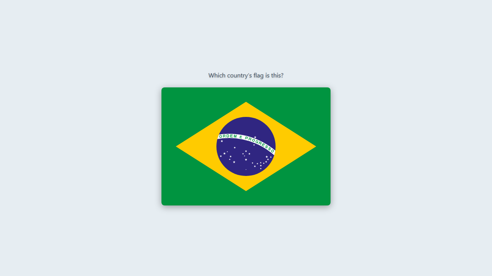

## Studying the World Map

Learn to recognise every country on a map, and a few facts about each one. 197 countries, one note each: the 193 UN members plus Vatican City, Palestine, Taiwan and Kosovo.

### Cards
#### 1. Locate

#### 2. Flag to Country

### Maps
Every map is an SVG, so it stays sharp at any zoom. Each is a north-up view at a similar ground scale, so you get a feel for relative size, with the country in red and its neighbours in grey. Tiny countries get a dot and an inset so they are still findable. The map is scaled to fill the card on desktop and phone.

### What the back of the card shows

- Name
- Flag
- Region
- Capital
- Bordering countries
- Languages
- Currency
- Government
- Religion
- Population *(ranked)*
- GDP *(ranked)*
- GDP per capita *(ranked)*
- Land area *(ranked)*
- Density *(ranked)*
- Happiness score *(ranked)*
- Leader, party and head of state

Ranked values show the country's world ranking, like *57,532,493 (#26/197)*. Empty rows are hidden.

### Organisation
Eight numbered sub-decks, one per region:
 - 01.  North America
 - 02. South America
 - 03. Europe
 - 04. Africa
 - 05. Central America
 - 06. Caribbean
 - 07. Asia
 - 08. Oceania.

Within the deck, countries are ordered by population, largest first.

### Accuracy
- Data was gathered in 2025. Leaders and parties change often, so check anything that matters.
- Some values are blank where no source had a figure: government type (52 countries), religion (15 micro-states), happiness (51), party (36) and GDP (North Korea, Taiwan, Vatican City).
- Borders are land borders only. Island countries have none, and bridge or causeway links (Singapore, Bahrain) do not count.

### Sources
Country shapes from Natural Earth (public domain). Capitals, languages, currency, government and flags from Wikidata and Wikimedia Commons. Population, GDP, land area and density from the World Bank. Leaders and religion (Pew, 2020) from Wikipedia. Happiness from the World Happiness Report, via Our World in Data.

### Source code
The scripts and data that generate this deck are on GitHub: [jackindisguise/studying-the-world-map](https://github.com/jackindisguise/studying-the-world-map).
