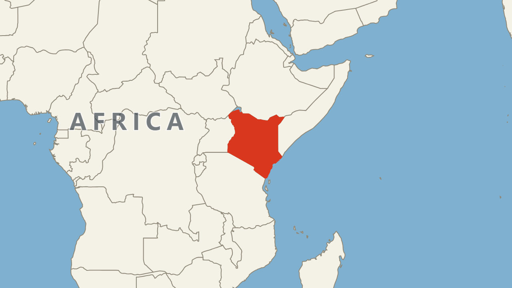
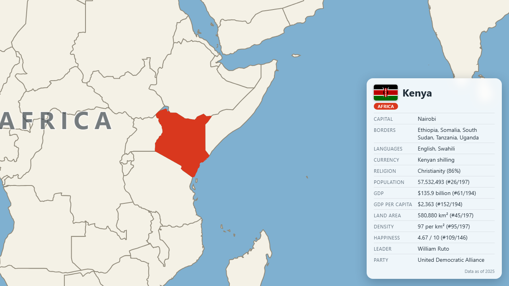
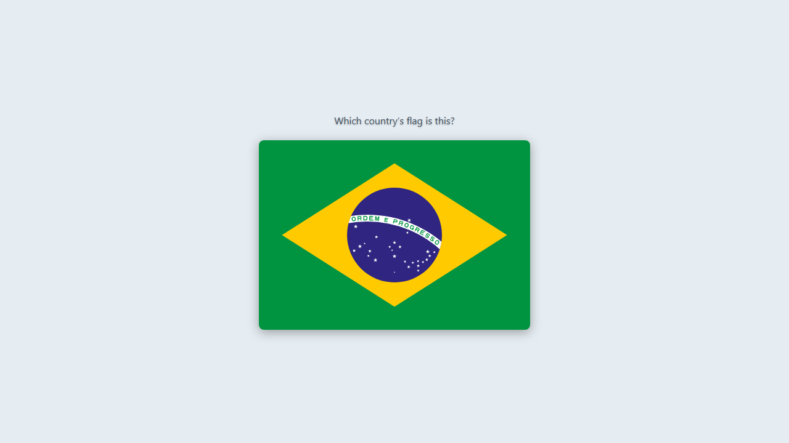
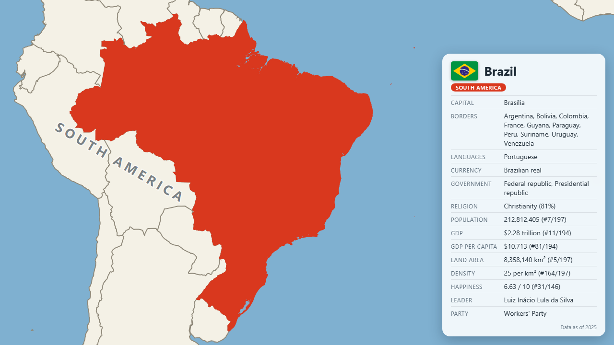
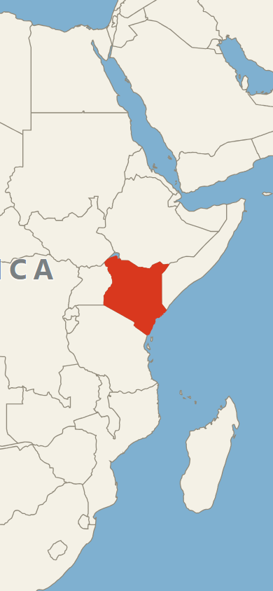
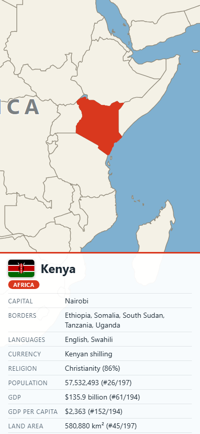
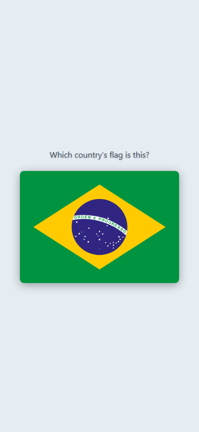
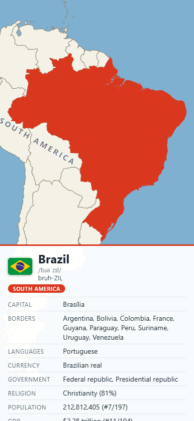

# 🌍 Studying the World Map

 <!-- x-release-please-version -->
  
 

**Learn to recognise every country on a map, and a few facts about each one.**
197 countries, one note each: the 193 UN members plus Vatican City, Palestine, Taiwan and Kosovo.

---

## Cards

### 1. Map to Country
Find the red country on a north-up map, then flip for the answer and its facts.

### 2. Flag to Country
Name the country from its flag.

### On a phone
The cards fill the screen on a phone too: the map on top, and the details below it on the back.

---

## Maps
- **Sharp at any zoom:** every map is an SVG.
- **Real relative size:** each is a north-up view at a similar ground scale, with the country in red and its neighbours in grey.
- **Tiny countries stay findable:** they get a dot on the main map plus a zoomed-in box in the top-left corner with a scale bar (Monaco, Malta, Singapore, Vatican City and more). Island groups too spread out to zoom keep just the dot.
- **Fits every screen:** the map is scaled to fill the card on desktop and phone.

---

## What the back of the card shows
- **Name**, flag and region
- **Capital**
- **Bordering countries**
- **Languages** and **Currency**
- **Government**, **Religion**
- **Leader**, party and head of state
- **Ranked numbers:** population, GDP, GDP per capita, land area, density and happiness score

> Ranked values show the country's world ranking, like *57,532,493 (#26/197)*. Empty rows are hidden.

---

## Organisation
Eight numbered sub-decks, one per region:

1. North America
2. South America
3. Europe
4. Africa
5. Central America
6. Caribbean
7. Asia
8. Oceania

Within the deck, countries are ordered by population, largest first.

---

## Accuracy
- Data was gathered in 2025. Leaders and parties change often, so check anything that matters.
- Some values are blank where no source had a figure: government type (52 countries), religion (15 micro-states), happiness (51), party (36) and GDP (North Korea, Taiwan, Vatican City).
- Borders are land borders only. Island countries have none, and bridge or causeway links (Singapore, Bahrain) do not count.

---

## Sources
- **Shapes:** Natural Earth (public domain). The Monaco and Vatican City outlines in the zoom boxes are OpenStreetMap contributors (ODbL, openstreetmap.org/copyright).
- **Capitals, languages, currency, government, flags:** Wikidata and Wikimedia Commons.
- **Population, GDP, land area, density:** World Bank.
- **Leaders and religion (Pew, 2020):** Wikipedia.
- **Happiness:** World Happiness Report, via Our World in Data.

---

## Source code
The scripts and data that generate this deck are open source: [jackindisguise/studying-the-world-map](https://github.com/jackindisguise/studying-the-world-map).
